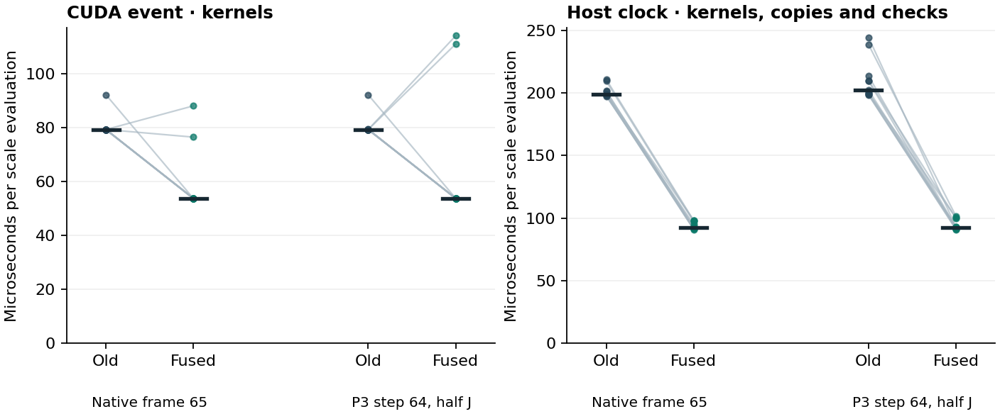

# Cryer 常渗透率步长归约在 RTX 3050 上的回放

在 12 组冻结状态及 18 组边界输入上，双遍与融合 CUDA 归约得到逐位相同的三项双精度输出。B64 第 64 步的半步 J 上，原始两个核函数合计中位数为 79.30 µs，融合核为 53.81 µs。就这个算例的短窗耗时而言，这项改动排在力与孔压邻域遍历的后面。

## 输入与数值检查

- 从保留的原生 26 列表中取出 Part 0、32、63、64、65、128、256、400、576 的完整双精度 J。Part 64 对应排水事件，Part 65 是事件后的第一个保存帧。另从 B64 第三轮全材料 CSV 取出实际第 64 次更新的 Jn、Jhalf、Jfull。每组均含 37,173 个材料粒子，12 组合计 446,076 个材料样本。ID 0–7 由原生 ID 表确认为边界，未参与归约。B64 表只含材料粒子，回放为其 8 个前缀边界槽位填入 NaN。粒子按原生 ID 排列，归约的无效索引指回放数组槽位。
- 原始基准从冻结的 JSphGpu_ker.cu 提取原版 KerDynamicConductivity、KerComputePorosityWaveSpeed2 及其 256 线程启动函数。未加观测写入的基准核和既有 128 线程候选分别生成正式归约值。另编译原版观测核和调用同一候选 Evaluate 的观测核，单独输出逐槽数据。实测 SM86，CUDA 11.7，启用与保留构建相同的 `-use_fast_math`。
- 30 组共检查 1,340,154 项逐槽 binary64 值、893,436 项独立有效标志，每组另比对 3 项全局最大值、2 个最小无效槽位、两条主机检查路径的首个错误类别。各项均一致。第 64 步 Jhalf 的最大有限 Kw 波速平方为 318742.39617123356，最大骨架波速平方为 1282.0513384084684，最大扩散率为 0.67981087498076287。
- 鉴别失败顺序的输入中，骨架条件最先在 0 号槽失败、有限 Kw 条件在 1 号槽失败。原路径第一遍就退出，两条路径都先报告有限 Kw 错误。另有只有骨架失败、空集合、零 k 时无效的 gamma、衰减条件失效、溢出、J 边界、非正混合密度、跨块重复无效值，以及前缀、固定、周期和排除粒子的屏蔽测试。
- 对允许进入后续计算的 16 组输入，再给定三组加速度、速度和黏性极值，比较力学 CFL、骨架和有限 Kw 波速 CFL、水力界、所选必要界、固定步长与该界的有符号差、超限判定，共 336 项一致。这里的三个力阶段极值组合是测试输入。冻结 J 表未保存每个力阶段的完整极值，这一部分只覆盖公式和判定。

## 计时

下表单位为 µs/次步长归约。先预热两组，每路径交替先后顺序测 11 对。核函数一栏以 CUDA events 计 16 次一批，每次有独立的预初始化输出区。包含复制及检查的独立计时从主机时钟读取，2 次一批。该栏保留原路径的两次初始化和四次同步回读，融合路径一次上传汇总初值、一次回读。两栏各自计时，不能相加。输入上传、分配、逐粒子诊断、文件 I/O 均在计时窗之外。

| 冻结状态 | 口径 | 原路径中位数 | 融合中位数 | 配对差中位数 | 融合更快的组数 |
|---|---|---:|---:|---:|---:|
| 原生 Part 65 | 核函数 | 79.30 | 53.76 | 25.53 | 10/11 |
| B64 更新 64，Jhalf | 核函数 | 79.30 | 53.81 | 25.52 | 9/11 |
| 原生 Part 65 | 含同步复制及检查 | 198.85 | 92.30 | 106.85 | 11/11 |
| B64 更新 64，Jhalf | 含同步复制及检查 | 202.35 | 92.65 | 109.70 | 11/11 |



RTX 3050 运行 Windows WDDM，原有 C08 计算进程 PID 43828 在计时前后均存在。两次利用率快照分别为 20% 与 2%。核函数配对差分别出现过 −8.77 和 −34.75 µs。按 B64 原有 320 次评估折算，核函数节约约 0.0082 s，计入上述复制与检查约 0.034–0.035 s，相当于既有 50.9536 s 循环时间的约 0.07%。这个数量级只用于安排本机优化工作，服务器耗时及集成后整步收益仍需另测。

## 复现

本轮于 2026-11-19 20:39:10–20:39:11 JST 完成。源码取自 tests/outputs/cryer_p3_gpu_r2_source，提取原核文本 SHA-256 为 `b1523886f66ba9361e1ad547f7c6b50fa5f21dbb24452d24a2a641d3f08e420d`，私有回放程序 SHA-256 为 `29616bf2736c635f1e1cf9a312a02752e26b84de92a5470f6fdbd70cb9ff4f73`。原始支持文件、输入片段与程序的哈希、完整编译命令见 [build.json](../outputs/cryer_dt_gpu_r1/build.json)。[逐组检查](../outputs/cryer_dt_gpu_r1/checks.csv)、[逐组计时](../outputs/cryer_dt_gpu_r1/timings.csv) 和 [执行记录](../logs/cryer_dt_gpu_r1.check.json) 可独立核查。

在本 case 的 tests 目录中使用新标签重放。

```powershell
& 'D:/Anaconda3/python.exe' support/cryer_dt_gpu_r1.py prepare --tag cryer_dt_gpu_repeat
& 'D:/Anaconda3/python.exe' support/cryer_dt_gpu_r1.py measure --tag cryer_dt_gpu_repeat
& 'D:/Anaconda3/python.exe' support/cryer_dt_gpu_plot_r1.py cryer_dt_gpu_repeat
```

候选的适用范围为 C04 的常渗透率模型。此次运行的是独立设备回放程序，五相时钟、完整求解器重启与场演化不在本轮验证范围。
